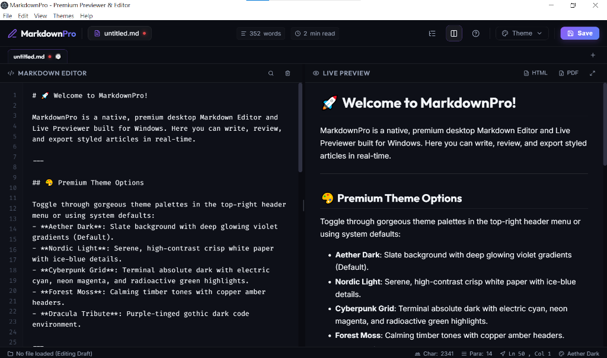
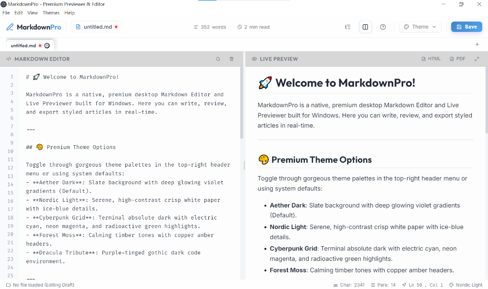

# MarkdownPro

一款以 Electron 建立的 Windows Markdown 編輯器，提供即時預覽、多分頁與文件匯出功能。

<p align="center">
  
  
</p>

## 功能

- Markdown 即時預覽、編輯與預覽捲動同步。
- 多分頁、未儲存變更提示、外部檔案變更提示。
- Mermaid 圖表、KaTeX 數學公式與程式碼語法標示。
- 文件大綱、搜尋與取代、圖片拖放、字數統計。
- 多種主題，以及 HTML、PDF 與圖片匯出。

## 開發與執行

需要 Windows、Node.js 及 npm；建議使用 Node.js 22.12 以上版本。

```powershell
git clone https://github.com/futeeeen/markdown-editor.git
cd markdown-editor
npm ci
npm start
```

## Windows 打包

| 指令 | 產物 |
| --- | --- |
| `npm run dist` | `dist/MarkdownPro-win32-x64/` 可攜式資料夾，需保留整個資料夾才能執行 |
| `npm run build:installer` | `dist/` 中的 Windows 安裝程式（NSIS） |
| `npm run build:portable` | `dist/` 中的可攜式執行檔 |

打包後的應用程式不需要另行安裝 Node.js。詳細說明見 [發佈與使用指南](DISTRIBUTION-GUIDE.md)。

## 專案結構

| 路徑 | 用途 |
| --- | --- |
| `main.js`、`preload.js` | Electron 主程序與介面橋接 |
| `index.html`、`renderer.js`、`style.css` | 編輯器介面與功能 |
| `assets/` | 字型、圖示程式庫與 README 截圖 |
| `build/` | Windows 打包圖示 |
| `scripts/` | 可攜式版本的 Windows 設定腳本 |
| `dist/` | 本機產生的打包結果，不納入 Git |

## 技術

Electron、Marked、Mermaid、KaTeX 和 Highlight.js。

## 授權

`package.json` 標示為 MIT；目前 repository 尚未附上完整授權條款。
